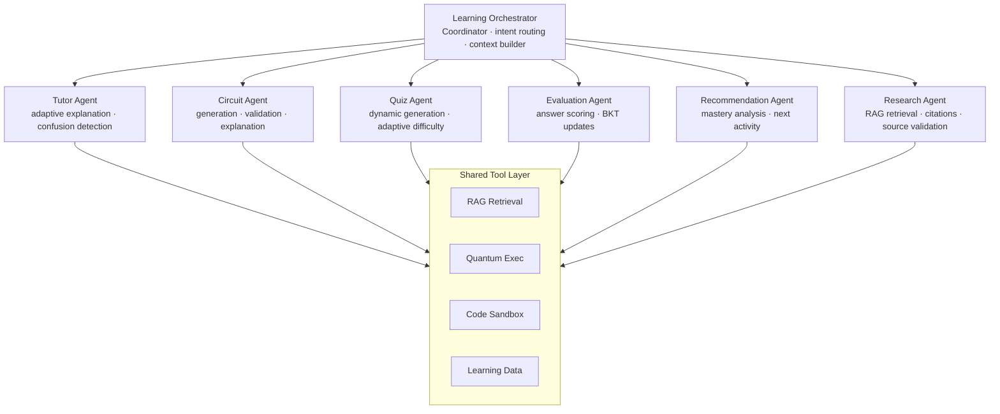
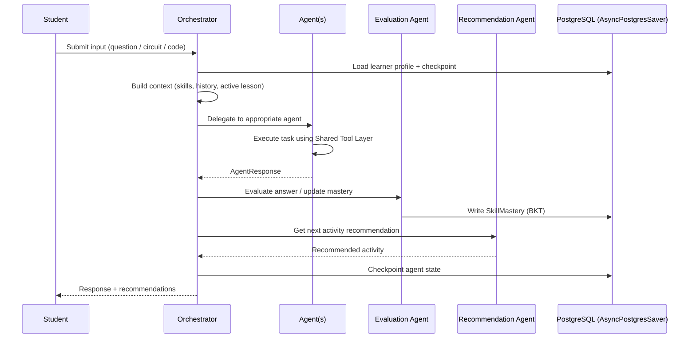
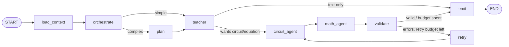

# AI Agent Architecture

> Implementation detail: [`backend/design.md § AI Agent Backend`](../backend/design.md)
> LLM routing and RPM management: [`docs/llm-model-router.md`](llm-model-router.md)

---

## Agent Topology

---

## Agent Responsibilities

| Agent | Key Responsibility |
|-------|--------------------|
| **Orchestrator** | Central coordinator, intent understanding, agent selection |
| **Tutor** | Adaptive concept explanation, confusion detection |
| **Circuit** | Circuit generation, validation, explanation, error detection |
| **Quiz** | Dynamic question generation, adaptive difficulty |
| **Evaluation** | Answer/circuit/code evaluation, misconception detection, BKT updates |
| **Recommendation** | Mastery analysis, weak concept identification, next activity |
| **Research** | Reliable information retrieval, citations, source validation |

Teaching progression (Tutor Agent): **Concept → Intuition → Mathematics → Circuit → Code → Simulation → Practice**

---

## Communication Flow

---

## State Persistence

LangGraph agent state is checkpointed with **`AsyncPostgresSaver`**, but only the **AI Classroom** graph uses it today (the single-call Tutor is a plain streaming chain with no checkpointer).

- psycopg needs a direct or session-mode connection, **not** the `:6543` transaction pooler `DATABASE_URL` normally points at. Set `CHECKPOINT_DATABASE_URL` (plain `postgresql://…`); when unset, `DATABASE_URL` is used only if it is not on the pooler.
- The saver is opened in the FastAPI lifespan (background task, `setup()` once) on its own `psycopg_pool` pool; `app/agents/classroom/checkpointer.py` also enables RLS on the four tables the saver creates (`checkpoint_*`), which are managed by LangGraph, not Alembic.
- If it cannot be opened the classroom **degrades gracefully**: the graph compiles without a checkpointer (a warning is logged, runs are just not resumable). Chat history and the board are persisted by the service either way, so teaching keeps working.
- `thread_id` = the classroom session UUID (server-derived, never client supplied). Every per-turn state key is reset by `initial_state()`, because a checkpointed thread otherwise keeps the previous turn's values.
- Session history is queryable from `agent_sessions` / `agent_messages`.

---

## AI Classroom Workflow (`app/agents/classroom/`)

A multi-agent LangGraph workflow behind `/api/v1/classroom`. Text only (voice, web research and sandbox simulation are deferred). All prompts live in `prompts.py`.

| Node | Responsibility |
|------|----------------|
| `load_context` | Bounded context (`context.py`): last 8 messages (or the rolling summary + last 4), board digest from the latest snapshot, up to 3 RAG chunks via `retrieve()`, the 3 weakest `SkillMastery` concepts (read-only, agents never write the profile). Hard cap 8,000 chars |
| `orchestrate` | Intent (`explain`/`circuit`/`math`/`followup`) from keyword heuristics first; the LLM classifier runs only when the message carries no signal. A complex request (long, "step by step", circuit + equation) sets `needs_plan` |
| `plan` | Bounded plan (title + at most 4 plain-text steps), only for complex requests; a simple question gets a trivial plan with no LLM call |
| `teacher` | Streams the spoken-friendly explanation (tokens to the batcher) between `step_started` and the visuals |
| `circuit_agent` | Proposes a circuit as JSON. It never executes anything and never states measurement results |
| `math_agent` | Up to 3 LaTeX equations |
| `validate` | Deterministic reviewer (no LLM): whiteboard schema (closed gate catalog, qubit range, size caps, no HTML/URLs) then `QiskitAerAdapter.validate` through the `QuantumBackend` interface. Invalid drafts go back once with the error text |
| `emit` | Emits the verified actions (circuit, highlight, caption annotation, equations), a `tutor_error` for anything that failed, then `step_completed` |

Budget: at most **4 LLM calls per turn** (`MAX_LLM_CALLS`), typically 1 to 3, and at most **1** validation retry; optional work is skipped once the budget is spent, and a failed visual never fails the text answer. JSON is parsed from the model output and validated with Pydantic rather than `with_structured_output`: `get_llm()` returns a `RunnableWithFallbacks`, whose attribute delegation would bind structured output to the primary model only and silently drop the fallback chain.

The graph never touches the database: collaborators arrive through `config["configurable"]` (`emitter`, `context_loader`), which keeps it testable with fakes. The service (`classroom_service.py`) owns persistence, leasing and publishing; see `docs/data-flow.md`.

Whiteboard actions are a versioned, strict Pydantic discriminated union in `app/schemas/whiteboard.py`; the pure `apply_event` reducer there is mirrored by the frontend.
