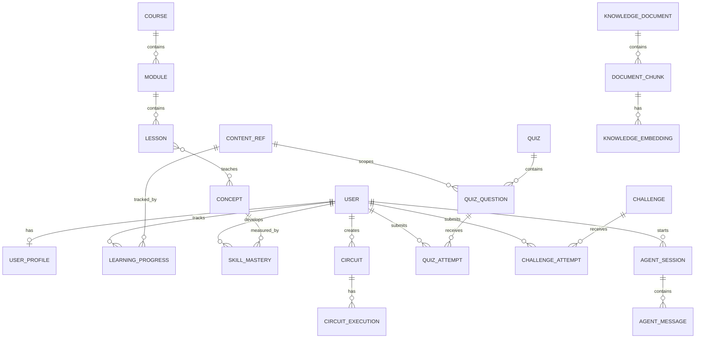
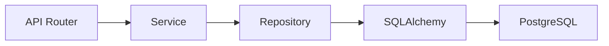

# Database Architecture

**Primary database:** PostgreSQL 16 + pgvector  
**ORM:** SQLAlchemy 2.x (async) · **Migrations:** Alembic · **Driver:** asyncpg

---

## Entity Relationships

---

## Key Tables

| Table | Purpose | Key Fields |
|-------|---------|------------|
| `users` | Authentication | uuid, email (UK), password_hash, role, timestamps |
| `user_profiles` | Extended user info | display_name, skill_level, preferences |
| `courses` | Course container | title, description, status |
| `modules` | Course modules | course_id FK, title, position |
| `lessons` | Individual lessons (legacy; learner state references content_refs, not lessons) | module_id FK, title, content, position |
| `content_refs` | Stable identity for CMS-authored content (integration boundary with Payload). Lesson rows are created or bound on publish via `POST /api/v1/internal/content-refs` | id (UUID, backend-owned), payload_id TEXT, kind ∈ curriculum/level/module/lesson, UNIQUE(kind, payload_id) |
| `concepts` | Quantum concepts | name, description, difficulty |
| `student_progress` | Lesson completion | user_id FK, lesson_id FK → content_refs, status, completion |
| `skill_mastery` | BKT student model | user_id FK, concept_id FK, mastery_score, confidence |
| `circuits` | Saved circuits | user_id FK, name, circuit_definition JSON, backend |
| `circuit_executions` | Execution results | circuit_id FK, status, probabilities, measurements, statevector, time |
| `quiz_questions` | Quiz questions | lesson_id FK → content_refs, concept_id FK, question_text, question_type, options, correct_answer |
| `quiz_attempts` | Quiz attempts | user_id FK, question_id FK, answer, is_correct, score |
| `coding_challenges` | Code challenges | title, description, difficulty, expected_result |
| `challenge_attempts` | Challenge attempts | user_id FK, code, result, score |
| `agent_sessions` | Agent conversations (`session_type` tutor/circuit/quiz/evaluation/classroom) | user_id FK, session_type, context JSON (there is no `metadata` column) |
| `agent_messages` | Agent messages | session_id FK, role, content, tool_calls, citations, plus nullable `agent_name`, `turn_id`, `client_message_id` (classroom; UNIQUE(session_id, client_message_id) makes retried turns idempotent) |
| `classroom_sessions` | AI Classroom session; `id` is the LangGraph `thread_id` | user_id FK, agent_session_id FK (messages live in `agent_messages`), title, status idle/running/completed/failed, active_run_id, run_lease_expires_at, summary, summary_version, last_event_seq |
| `whiteboard_events` | Durable ordered whiteboard actions | session_id FK, sequence_no, event_id, schema_version, event_type, step_id, turn_id, payload JSONB; UNIQUE(session_id, sequence_no) and UNIQUE(session_id, event_id) |
| `whiteboard_snapshots` | Materialised board state | session_id PK/FK, version, board_state JSONB, last_sequence_no |
| `knowledge_documents` | Source documents | title, source_url, source_type, version |
| `document_chunks` | Chunked content | document_id FK, content, metadata, chunk_index |
| `knowledge_embeddings` | Vector embeddings | chunk_id FK, embedding vector(384), model |

`knowledge_embeddings.embedding` uses `pgvector.sqlalchemy.Vector(384)` with an HNSW (cosine) index (`document_chunks.content_tsv` has a GIN index for the full-text arm; see `docs/rag-pipeline.md`). `document_chunks` has no `metadata` column.

**AI Classroom tables** (migration `f6a7b8c9d0e1`, additive, RLS enabled with no policies like every other table):

- Sequence numbers are allocated atomically with `UPDATE classroom_sessions SET last_event_seq = last_event_seq + 1 WHERE id = :id AND active_run_id = :run RETURNING last_event_seq`. The same statement proves the writing run still owns the board, so a superseded or interrupted run gets no number and its late events are dropped.
- `run_lease_expires_at` is extended by every event; a `running` session whose lease has expired is reported as `failed` and never blocks a new turn.
- Snapshots are written at step boundaries, every 10 events and when a turn ends; `snapshot + events after it == full replay`.
- LangGraph's own `checkpoints`/`checkpoint_blobs`/`checkpoint_writes`/`checkpoint_migrations` tables are created by `AsyncPostgresSaver.setup()` (not Alembic); RLS is enabled on them at startup.

---

## Migration Strategy

- **Never use `Base.metadata.create_all()`** in production
- All schema changes go through Alembic revisions
- Flow: Model change → `alembic revision --autogenerate` → review → `alembic upgrade head`

---

## Dependency Direction

Business logic belongs in the Service layer — not in routers or ORM models.
